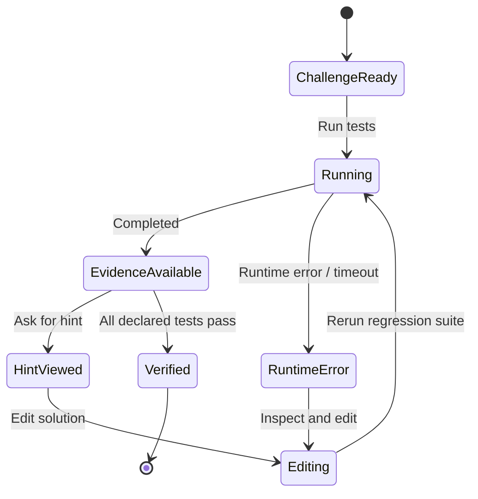
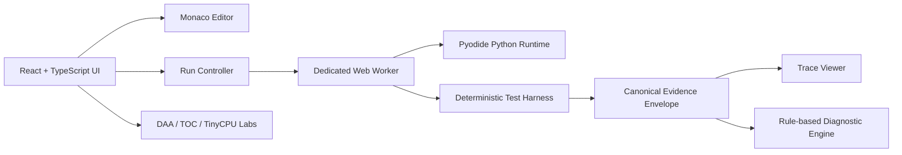

# TRACEFORGE Master Specification

**Version:** 1.1 (repository baseline)  
**Status:** Proposed implementation contract; not a claim that every feature is implemented.  
**Product:** Evidence-First Debugging & Learning Lab  
**Tagline:** Don't just fix the bug. Prove why it failed.

## 1. Executive summary

TRACEFORGE helps computer-science students move from a reproducible programming failure to a reasoned, verified fix. Its core loop is: reproduce → inspect evidence → understand → change → rerun. Four academic subjects contribute executable learning modules: AI foundations, DAA, Theory of Computation, and Computer Organization & Architecture. The project must prioritize a small end-to-end workflow over superficial coverage of every syllabus topic.

## 2. Assumptions and non-goals

- Primary users are undergraduate CS students and instructors.
- First supported language: Python; first challenge: Binary Search.
- Initial release is a local/browser prototype, not a production multi-tenant code-hosting service.
- Deterministic tests and trace evidence are authoritative; AI-generated explanations are optional and must not invent runtime facts.
- The course's exact DAA module outline is not yet verified. Map topics to the official syllabus before submission.
- The educational CPU is a deliberately simplified teaching model, not a cycle-accurate commercial CPU.
- No design assets are specified here; this document covers behavior and implementation contracts.

Non-goals for MVP: arbitrary server-side code execution, multi-language judge, user accounts, payments, social feed, model training, and enterprise-scale microservices.

## 3. Problem, users, value

Students often receive a failed test or an error message without a useful explanation of the path that caused it. Existing editors execute code; algorithm visualizers show selected algorithms; neither alone necessarily links a student's own failing case to evidence, a progressive hint, and a regression-tested fix.

Primary personas:
1. Beginner who needs conceptual, non-spoiler hints.
2. DSA learner comparing correctness and complexity.
3. TOC learner exploring machines and grammars.
4. COA learner tracing instruction and pipeline behavior.
5. Instructor validating that explanations and tests are reproducible.

## 4. Goals and measurable outcomes

MVP goals:
- A known Binary Search defect reproduces on a named test.
- The UI shows expected output, actual output, pass/fail and stable run identifier.
- Each diagnostic statement links to observed evidence or is explicitly marked as a hypothesis.
- User can edit code and rerun the same regression suite.
- Tests, type checks, lint and production build are run and their real outcomes recorded.

Pilot metrics (targets, not achieved claims):
- ≥80% of pilot users reproduce the provided failure without help.
- ≥70% can explain the failing condition after using hints.
- ≥70% can fix the challenge and pass regression tests.
- Median time-to-first-evidence under 3 minutes.
- Zero unbounded execution paths in the MVP test suite.

## 5. Prioritization

### MVP / P0 — Binary Search debugging vertical slice
- Challenge brief and buggy starter code.
- Deterministic test runner for supported examples.
- Expected-versus-actual result panel.
- Trace schema and trace viewer.
- Progressive hints tied to observed test evidence.
- Editable solution and regression rerun.
- Clear distinction between “these tests passed” and “program is correct.”

Acceptance criteria:
1. The seeded buggy implementation fails at least one named regression case.
2. The correct reference implementation passes all declared cases.
3. A run result contains challenge ID, code revision/hash, test IDs, status and timestamp/session ID.
4. UI never labels an unexecuted test as passed.
5. A fix can be submitted and the exact failing test rerun.
6. Invalid input and runtime errors render useful, non-crashing states.

### V1 — DAA and TOC labs
- Linear vs binary search; simple sorting comparisons.
- Operation counters and stated complexity, with counting assumptions visible.
- FSM transition runner and regular-expression examples.
- Limited CFG parsing/parse tree for curated grammars.
- Challenge progress stored locally with user control.

Acceptance: every visualized step derives from a deterministic engine result; test coverage includes boundary cases.

### V2 — COA and advanced diagnosis
- Tiny educational instruction set with registers, memory and step execution.
- Simple pipeline stages, data/control hazards and stalls.
- Optional property-based testing / counterexample shrinking.
- Optional AI explanation provider behind an explicit interface, disabled by default.

Acceptance: CPU model's instruction semantics and pipeline assumptions are documented and covered by golden tests; AI cannot change test outcomes.

## 6. User journey and core states



Run statuses: `queued`, `running`, `passed`, `failed`, `runtime_error`, `timeout`, `cancelled`. A test status must never be inferred from UI state alone.

## 7. Canonical evidence contract

All modules should emit a common envelope; module-specific fields may be nested under `details`.

```json
{
  "schemaVersion": "1.0",
  "runId": "run_local_uuid",
  "challengeId": "daa.binary-search.first-bad",
  "engine": "python-browser",
  "codeHash": "sha256:...",
  "status": "failed",
  "tests": [{
    "testId": "empty-input",
    "status": "passed",
    "expected": -1,
    "actual": -1
  }, {
    "testId": "target-at-right-boundary",
    "status": "failed",
    "expected": 4,
    "actual": -1
  }],
  "trace": [{
    "step": 1,
    "event": "condition_evaluated",
    "variables": {"left": 0, "right": 4, "mid": 2},
    "evidenceRef": "target-at-right-boundary"
  }],
  "createdAt": "ISO-8601 timestamp"
}
```

Use structured values, not arbitrary HTML. Redact secrets from logs. Store only what is necessary for the learning session.

## 8. Diagnostic and coaching rules

1. State the observed failure first.
2. Link each claim to a test result, trace event, or documented rule.
3. Use progressive hints: (a) direct attention, (b) explain relevant invariant, (c) suggest a next debugging step, (d) reveal a worked explanation only when requested.
4. Never silently replace student code with a solution.
5. Separate facts from inferred causes; label uncertain diagnoses.
6. Re-run tests after a change; never infer a fix from an edit alone.
7. A finite test suite passing is evidence for those cases, not proof of universal correctness.
8. AI output is untrusted explanatory text. It cannot override deterministic results, execute tools, or mark tests passed.

## 9. Architecture



Recommended boundaries:
- UI: presentation, accessibility, user actions.
- Challenge registry: curated prompts, starter/reference code, tests and hints.
- Execution adapter: starts, times out, terminates and resets a worker.
- Test harness: compares normalized outputs.
- Trace adapter: validates and normalizes trace events.
- Diagnostic engine: pure functions over evidence.
- Persistence adapter: local progress only for MVP.

Do not start with microservices. Keep the core deterministic engine independent of UI and AI provider.

## 10. Open-source adoption policy

| Dependency/reference | Planned role | Decision gate |
|---|---|---|
| Monaco Editor (MIT) | Code editor UI | Adopt after bundle/accessibility check |
| Pyodide (MPL-2.0) | Browser Python runtime | Prototype; test timeout, worker termination and package size |
| Hypothesis (MPL-2.0) | Python property-based testing and shrinking | Later; likely Python-side test workflow, not direct browser UI dependency |
| Automata-lib (MIT) | Automata logic reference/library | Use only if Python engine boundary is chosen |
| Lark (MIT) | Python grammar/parser | Use for curated CFG lab if useful |
| React Flow / XYFlow (MIT) | Interactive graphs | Optional; static SVG may suffice first |
| Algorithm Visualizer (MIT) | Learning/reference | Study patterns; do not copy wholesale |
| Ripes (MIT) | CPU simulator reference | Study model and tests; not a React component |
| Judge0 (GPL-3.0) | Possible future remote execution | Defer; security and legal review required |

Pin dependency versions, preserve license notices, review transitive dependencies, and check current upstream licenses before release. This table is a screening aid, not legal advice.

## 11. API/interface contracts

For the first browser-only version, use typed internal interfaces rather than prematurely adding a network API.

```ts
export type RunStatus =
  | "queued" | "running" | "passed" | "failed"
  | "runtime_error" | "timeout" | "cancelled";

export interface RunRequest {
  challengeId: string;
  sourceCode: string;
  runId: string;
}

export interface TestResult {
  testId: string;
  status: "passed" | "failed" | "error" | "skipped";
  expected?: unknown;
  actual?: unknown;
  message?: string;
}

export interface EvidenceReport {
  schemaVersion: "1.0";
  runId: string;
  challengeId: string;
  codeHash: string;
  status: RunStatus;
  tests: TestResult[];
  trace: TraceEvent[];
}
```

Normalize values carefully; reject circular/unserializable trace values and cap event count/size. Do not include source code in analytics events.

## 12. Data and privacy

MVP data entities: Challenge, ChallengeVersion, TestCase, Run, TestResult, TraceEvent, Hint, LearningSession, Feedback.

- Default to local/session storage for progress; no account required.
- Do not persist full source code unless explicitly needed and disclosed.
- Give a clear reset/delete-progress action.
- Telemetry, if added, should be opt-in/minimal and exclude code, inputs and personal data by default.
- Any future cloud sync needs authentication, authorization, retention policy and deletion behavior before release.

## 13. Security and safety

Threats: malicious/infinite-loop code, browser resource exhaustion, prototype pollution or unsafe rendering of user text, compromised dependency, secret leakage, misleading AI output, accidental data collection.

Controls:
- Execute untrusted code only in a dedicated worker; enforce wall-clock deadline and terminate/recreate worker on timeout.
- Do not expose privileged browser APIs to the worker intentionally; still treat browser execution as a usability boundary, not a hardened security sandbox.
- Avoid `eval`/dynamic HTML injection in app UI; render source/output as text.
- Bound source length, input size, trace event count, output bytes and execution time.
- Never put server secrets in `VITE_*` variables.
- Pin and audit dependencies; preserve license files.
- If remote execution is added, isolate it in disposable, network-restricted sandboxes with CPU/memory/time quotas and no credentials.

## 14. Quality gates

Every pull request should run:
- formatter/lint;
- TypeScript typecheck;
- unit tests for algorithm and diagnostics;
- integration tests for run → evidence → hints;
- production build;
- dependency/security scan where configured.

Golden tests must cover empty input, singleton input, duplicates, target absent, first/last index, invalid input, runtime exception and timeout. Tests should verify both the buggy starter's failure and reference solution's pass.

## 15. ADRs

Create one ADR per durable decision under `docs/adr/`, with status, context, decision, alternatives, trade-offs, security/privacy impact and rollback plan.

Initial ADRs:
1. Browser-first Python execution for MVP.
2. Canonical evidence envelope owned by TRACEFORGE.
3. Monaco as editor component.
4. Deterministic diagnostics before generative AI.
5. Local-first progress storage.
6. No server-side arbitrary execution in MVP.
7. Curated Python challenge registry.
8. Separate educational TinyCPU semantics from real hardware claims.
9. Dependency/license review before adoption.
10. Minimal/opt-in telemetry.

## 16. Delivery milestones

1. Repository and app scaffold boots.
2. Binary Search challenge and deterministic tests work.
3. Evidence envelope and trace viewer work.
4. Progressive hints link to evidence.
5. Editing and regression rerun verify a fix.
6. Boundary/runtime/timeout tests pass.
7. Pilot with 5–8 students; record observed feedback without inventing results.
8. Add DAA/TOC/COA labs only after MVP acceptance gates pass.

## 17. Definition of done

A feature is done only when its acceptance criteria are documented, tests actually run and pass, UI states are manually checked, accessibility basics are covered, security limitations are disclosed, and README/docs match the implementation. Never report unrun tests as passed.
